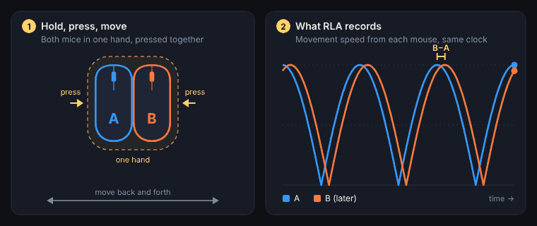
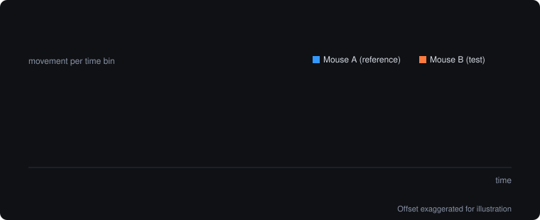
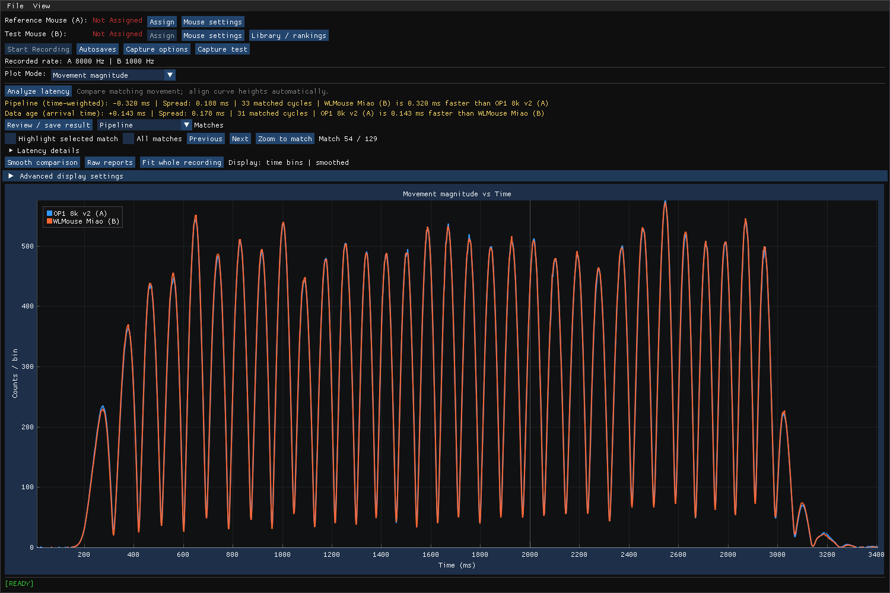
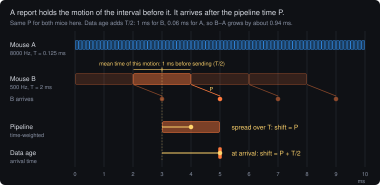
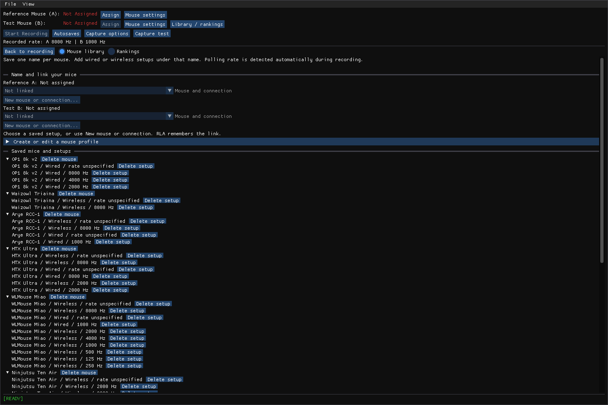
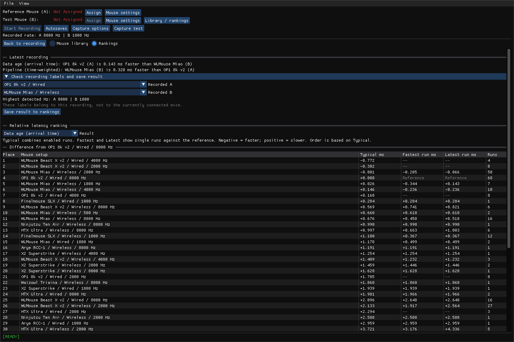

# Relative Latency Analyzer (RLA)

Compare the input latency of two mice on Windows, side by side, from one recording.

Move both mice together. RLA records every report from each mouse with a high-resolution timestamp. It then finds the same movement in both curves and measures how much later one mouse delivers it than the other. Results are kept per mouse, connection, and polling rate, and are ranked in a library.

**[Download for Windows x64](https://github.com/scherzma/RLA/releases/latest)** · [Installation guide](docs/INSTALL.md) · [Build from source](docs/BUILD.md) · [Technical details](docs/TECHNICAL.md)



## Highlights

- **Two mice, one recording.** Both mice share the same clock, so there is no external reference to calibrate.
- **Two results per run.** **Pipeline** compares the delay after each mouse samples its motion. **Data age** also includes how old the data already is when it arrives, which depends on the polling rate. [Read more](#pipeline-and-data-age).
- **Checks before results.** Matching minima, maxima, and slope points must agree in shape and direction over at least three movement cycles. Pauses, independent movement, and conflicting estimates are rejected.
- **Mouse library.** Name each physical mouse, keep wired and wireless setups apart, and rank all mice against a reference. The polling rate is detected from each recording.
- **Portable.** One executable. No installer, no runtime, no driver.

## Quick start

1. Download **RLA-*version*-windows-x64.zip** from [Releases](https://github.com/scherzma/RLA/releases/latest), extract it, and open **RLA.exe**. Windows 10 or 11, x64, DirectX 11.
2. **Assign A and B.** Click **Assign**, then move only that mouse. Use **Mouse settings** to name it and select wired or wireless.
3. **Start Recording.** Hold both mice in one hand, press them together, and move them back and forth through several smooth cycles.
4. **Stop** with a click or Esc. The recording is saved automatically.
5. **Analyze latency.** RLA shows both results, names the faster mouse, and gives the spread and the number of matched cycles. Linked mice are analyzed and ranked automatically.
6. **Inspect.** **Previous**, **Next**, and **Zoom to match** step through the matched points on the graph.

The [installation guide](docs/INSTALL.md) covers updates, saved files, and troubleshooting.

## How it works



1. Both mice make the same movement, because they are held and pressed together.
2. RLA puts the reports of each mouse into common time bins and smooths both curves the same way.
3. It finds the same features in both curves: minima, maxima, and the 50 % points on each slope. A feature counts only if the shape and direction around it match.
4. Each matched cycle votes once. **B−A** is the median, and **Spread** is how much the matched points vary.



*A real recording: OP1 8k v2 (A, wired, 8000 Hz) and WLMouse Miao (B, wireless, 1000 Hz). Pipeline: the Miao is 0.32 ms faster. Data age: the OP1 is 0.14 ms faster, because the Miao's 1 ms report interval adds about (1 − 0.125) / 2 = 0.44 ms of sampling age.*

## Pipeline and data age

A mouse sends one report per polling interval T. Each report holds the motion of the whole interval before it. On average, that motion is T/2 old when the report is sent.



| Result | What it measures | Use it for |
| --- | --- | --- |
| **Pipeline (time-weighted)** | Delay after sampling: sensor, firmware, link, and Windows. The counts of each report are spread over its interval, which removes the sampling age. | Comparing the hardware and firmware path, independent of the polling rate |
| **Data age (arrival time)** | Pipeline plus the mean sampling age, T/2. The counts stay at the time they arrive. | What the PC, and therefore the cursor, actually receives |

For B-A: **Data age = Pipeline + (T_B - T_A) / 2**.

| Polling rate | 125 Hz | 250 Hz | 500 Hz | 1000 Hz | 2000 Hz | 4000 Hz | 8000 Hz |
| --- | --- | --- | --- | --- | --- | --- | --- |
| Mean sampling age T/2 | 4 ms | 2 ms | 1 ms | 0.5 ms | 0.25 ms | 0.125 ms | 0.0625 ms |

Example: A at 8000 Hz, B at 500 Hz. If both have the same pipeline delay, Pipeline shows about 0 ms, and Data age shows B about (2 - 0.125) / 2 = 0.94 ms later. The regression checks verify this relation with synthetic recordings at 500 to 8000 Hz to within 0.01 ms.

## Library and rankings



Use one name for each physical mouse and link its wired and wireless connections to it. Each connection and detected polling rate gets its own ranking entry; DPI does not. Add setup notes to compare other settings separately.



- **Result:** choose **Pipeline** (default) or **Data age**. They are ranked separately.
- **Add sampling age:** in the Pipeline view, adds f × T per setup. It starts at **0.5**, the mean sampling age, so slower polling rates count against a mouse by default. 0 shows the pure pipeline delay, 1 the age of the oldest sample in a report. It is computed from the detected Hz, not measured; **Data age** is the measured counterpart.
- **Typical** combines all enabled runs and sets the order. **Fastest run** and **Latest run** are single runs against the named reference. Click one to open its recording.

**Negative means faster, positive means slower.** Separate tables appear only when no comparison connects their mice. The screenshots show real results from one library, not a general ranking of these mice.

## Saved files

Everything is stored in `%LOCALAPPDATA%\RLA`. Updating RLA keeps it.

| Path | Contents |
| --- | --- |
| `Autosaves` | Completed recordings |
| `Runs` | Recordings that belong to ranking results |
| `mice.json` | Mouse names, device links, and results |
| `Diagnostics` | Logs if the app stops responding |

**Autosaves > Open folder** shows the recordings; **File > Load Session** opens one again. Results from earlier analysis methods stay in the library. A library with Data age results cannot be opened by RLA versions before Data age was added.

## Measurement limits

- RLA compares two mice. It does not measure absolute click-to-photon or USB latency.
- The result includes everything from the motion to the application timestamp: sensor, firmware, wireless link, USB, and Windows input handling. Differences in how the two mice move also count.
- **Spread** shows how much the matched points vary. It is not an accuracy figure. Repeat runs and inspect the curves.
- Close input-sharing software. In local tests, an active Synergy reduced the observed event rate; closing it restored the rate.

## Build from source

Install Microsoft C++ Build Tools with **Desktop development with C++** and **C++ CMake tools for Windows**. Then, in PowerShell:

```powershell
git clone https://github.com/scherzma/RLA.git
cd RLA
git clone https://github.com/microsoft/vcpkg.git ..\vcpkg
..\vcpkg\bootstrap-vcpkg.bat
powershell -NoProfile -ExecutionPolicy Bypass -File .\build.ps1 -VcpkgRoot ..\vcpkg -Test -Package
```

This builds with CMake, Ninja, and vcpkg, runs the regression checks, and writes `out/cmake-release/RLA.exe` and a portable ZIP. Pass `-VcpkgRoot` with the path of an existing vcpkg checkout if you have one. [Build from source](docs/BUILD.md) covers direct CMake commands and Visual Studio.

## More

[Technical details](docs/TECHNICAL.md) · [Regression checks](tests/README.md) · [Capture diagnostic tools](tools/RawInputProbe/README.md)

Screenshots are rendered from a local library with `RLAScreenshots` (built with `-Test`); the diagrams come from `tools/Screenshots/diagrams.py` and `move_gif.py`.
